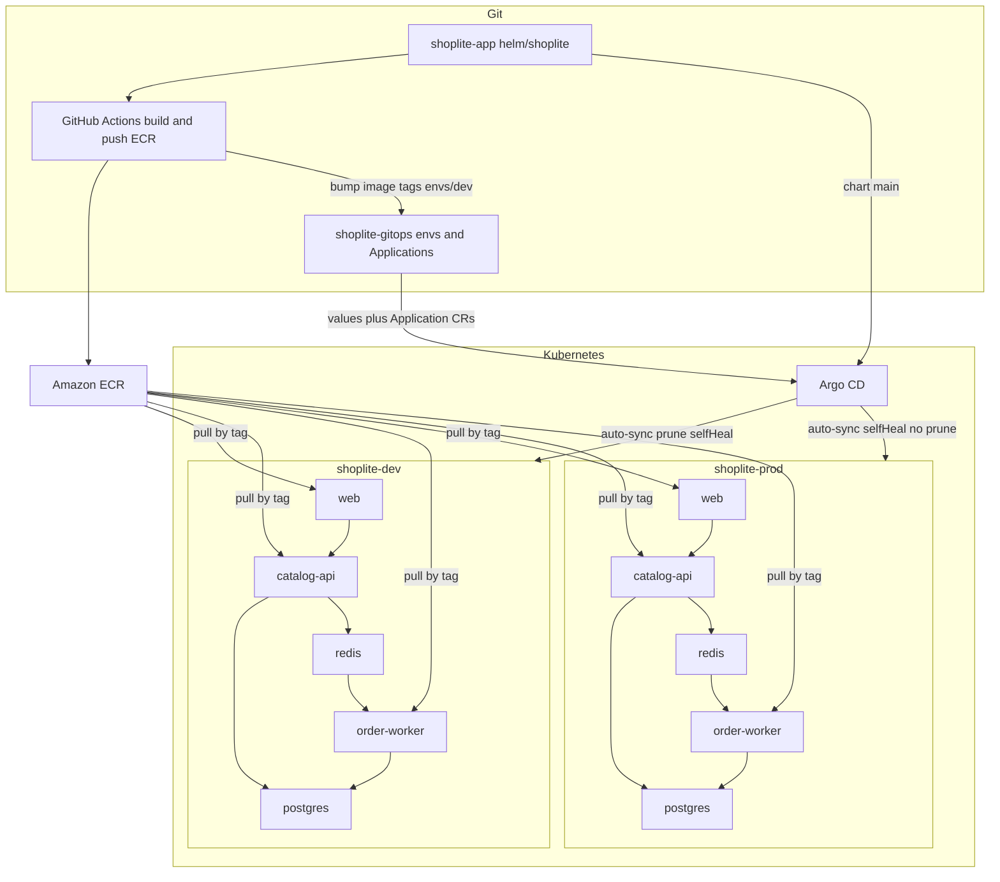
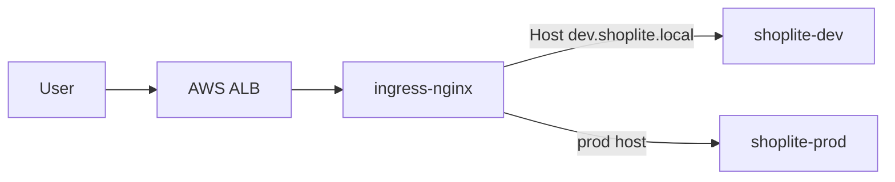

# shoplite-gitops

ArgoCD Applications and environment-specific Helm values for ShopLite.

The Helm chart lives in [shoplite-app](https://github.com/Swapno963/shoplite-app) (`helm/shoplite`). This repository supplies one ArgoCD Application per environment and the overlay values ArgoCD applies on top of the chart defaults.

```text
shoplite-gitops/
├── apps/
│   └── argocd-applications
│       ├── shoplite-project.yaml
│       ├── shoplite-dev.yaml
│       └── shoplite-prod.yaml
└── envs/
    ├── dev/
    │   └── values.yaml
    └── prod/
        └── values.yaml
```

## Architecture

Argo CD runs in-cluster (`argocd` namespace). Each environment is one `Application` in `AppProject/shoplite`. The chart is rendered from **shoplite-app** `helm/shoplite` on `main`; overlay values come from this repo (`envs/dev` or `envs/prod`).



Traffic path (unchanged by GitOps): ALB to ingress-nginx NodePort `30080`, then ClusterIP Services in `shoplite-dev` or `shoplite-prod`.



## Sync policy


| Environment | Application     | Namespace       | Git sync                           | Self-heal | Prune |
| ----------- | --------------- | --------------- | ---------------------------------- | --------- | ----- |
| Development | `shoplite-dev`  | `shoplite-dev`  | Automatic                          | Yes       | Yes   |
| Production  | `shoplite-prod` | `shoplite-prod` | Automatic (required for self-heal) | Yes       | No    |


## Bootstrap

Run these from a machine that can reach the cluster (`kubectl` context already set). Clone this repo so the `kubectl apply` paths resolve.

### 1. Install Argo CD

```bash
kubectl create namespace argocd
kubectl apply -n argocd -f https://raw.githubusercontent.com/argoproj/argo-cd/stable/manifests/install.yaml
```

Wait until the control plane is ready:

```bash
kubectl get all -n argocd
kubectl -n argocd rollout status deploy/argocd-server
```


### 2. Expose the Argo CD server

Port-forward the API/UI (HTTPS on 8080):

```bash
kubectl port-forward svc/argocd-server -n argocd 8080:443
```

Open [https://localhost:8080](https://localhost:8080) (accept the self-signed certificate). Leave this terminal running.

Optional CLI (install once: [https://argo-cd.readthedocs.io/en/stable/cli_installation/](https://argo-cd.readthedocs.io/en/stable/cli_installation/)):

```bash
argocd login localhost:8080 --insecure
```

Username is `admin`. Password is the value from the next step.

### 3. Get the Argo CD admin password

```bash
kubectl get secret argocd-initial-admin-secret -n argocd \
  -o jsonpath="{.data.password}" | base64 --decode
echo
```

Sign in to the UI with user `admin` and that password. Change it after first login if this is a shared cluster.

### 4. Register Git repositories

Both Applications read two repos. If either is private, add credentials in the UI (**Settings → Repositories → Connect Repo**) or with the CLI:

```bash
# PAT or GitHub App token with contents:read on both repos
export GITOPS_TOKEN=ghp_...


kubectl -n argocd create secret generic repo-shoplite-app \
  --from-literal=type=git \
  --from-literal=url=https://github.com/Swapno963/shoplite-app.git \
  --from-literal=username=git \
  --from-literal=password="$GITOPS_TOKEN"
kubectl -n argocd label secret repo-shoplite-app argocd.argoproj.io/secret-type=repository

kubectl -n argocd create secret generic repo-shoplite-gitops \
  --from-literal=type=git \
  --from-literal=url=https://github.com/Swapno963/shoplite-gitops.git \
  --from-literal=username=git \
  --from-literal=password="$GITOPS_TOKEN"
kubectl -n argocd label secret repo-shoplite-gitops argocd.argoproj.io/secret-type=repository
```

Use the same token Argo CD will use to fetch `helm/shoplite` and `envs/*/values.yaml`.

### 5. Apply the Argo CD Project and Applications

`AppProject/shoplite` must exist before the Applications (they set `spec.project: shoplite`). Apply the directory so the Project and both Applications are created:

```bash
cd shoplite-gitops

kubectl apply -n argocd -f apps/argocd-applications/shoplite-project.yaml
kubectl apply -n argocd -f apps/argocd-applications/shoplite-dev.yaml
kubectl apply -n argocd -f apps/argocd-applications/shoplite-prod.yaml
```

Or apply everything in that folder:

```bash
kubectl apply -n argocd -f apps/argocd-applications/
```


| Resource    | Name            | Role                                                                            |
| ----------- | --------------- | ------------------------------------------------------------------------------- |
| AppProject  | `shoplite`      | Allows those two GitHub repos and destinations `shoplite-dev` / `shoplite-prod` |
| Application | `shoplite-dev`  | Auto-sync, prune, self-heal into `shoplite-dev`                                 |
| Application | `shoplite-prod` | Auto-sync, self-heal, **no prune** into `shoplite-prod`                         |


`CreateNamespace=true` creates the destination namespaces. Cluster-scoped Namespace creates are allowed on the Project.

### 6. Create application secrets

Helm does not create `shoplite-secret`. Create it in each destination namespace or the pods stay unready:

```bash
kubectl create namespace shoplite-dev --dry-run=client -o yaml | kubectl apply -f -
kubectl create namespace shoplite-prod --dry-run=client -o yaml | kubectl apply -f -

kubectl -n shoplite-dev create secret generic shoplite-secret \
  --from-literal=POSTGRES_PASSWORD='my-db-password' \
  --from-literal=DJANGO_SECRET_KEY='my-django-secret' \
  --from-literal=REDIS_PASSWORD='my-redis-secret'

kubectl -n shoplite-prod create secret generic shoplite-secret \
  --from-literal=POSTGRES_PASSWORD='my-db-password' \
  --from-literal=DJANGO_SECRET_KEY='my-django-secret' \
  --from-literal=REDIS_PASSWORD='my-redis-secret


For update password
kubectl -n shoplite-dev create secret generic shoplite-secret \
  --from-literal=POSTGRES_PASSWORD='my-db-password' \
  --from-literal=DJANGO_SECRET_KEY='my-django-secret' \
  --from-literal=REDIS_PASSWORD='my-redis-secret' \
  --dry-run=client -o yaml | kubectl apply -f -
```


### 7. Confirm sync

```bash
kubectl -n argocd get appproject shoplite
kubectl -n argocd get applications
kubectl -n argocd get application shoplite-dev shoplite-prod -o yaml | less
```

Both Applications sync themselves once Git is reachable. Production auto-applies Git changes and self-heals drift, but does not prune resources that disappear from Git.

In the UI you should see `shoplite-dev` and `shoplite-prod` under project `shoplite`, moving to `Synced` / `Healthy` after the first reconcile (secrets and ECR pull must already work on the nodes).

## GitOps: page title change (no manual deploy)

This shows a UI change reaching the browser after Git pushes only. Do not run `helm upgrade`, `kubectl apply` on the app, or `argocd app sync shoplite-dev`. Development auto-syncs.

1. Change the document title in the web app (`shoplite-app`):

```bash
cd /path/to/shoplite-app
```

Edit `application/web/index.html` and set a new title, for example:

```html
<title>ShopLite GitOps</title>
```

1. Push the application change:

```bash
git add application/web/index.html
git commit -m "Change web page title"
git push origin main
```

1. Wait for GitHub Actions `Build Web` to push the image. Copy the commit SHA:

```bash
WEB_SHA=$(git rev-parse HEAD)
echo "$WEB_SHA"
```

Confirm the image exists (optional):

```bash
aws ecr describe-images \
  --repository-name shoplite-web \
  --image-ids imageTag="$WEB_SHA" \
  --region ap-southeast-1
```

1. Point development at that image in this GitOps repo and push. That Git commit is the desired state; ArgoCD applies it.

```bash
cd /path/to/shoplite-gitops
```

Set `web.image.tag` in `envs/dev/values.yaml` to `"$WEB_SHA"`, then:

```bash
git add envs/dev/values.yaml
git commit -m "Deploy web title change to development"
git push origin main
```

1. Wait for ArgoCD (no deploy command):

```bash
kubectl -n argocd get application shoplite-dev -w
kubectl -n shoplite-dev get deploy web -o jsonpath='{.spec.template.spec.containers[0].image}{"\n"}'
```

When `shoplite-dev` is `Synced` / `Healthy` and the web image tag matches `$WEB_SHA`, open the app:

```text
http://dev.shoplite.local
```

The browser tab title should be `ShopLite GitOps`. Hard-refresh if the old title is cached.

Production picks the same change up after `envs/prod/values.yaml` is updated and pushed; `shoplite-prod` auto-syncs. Prune stays off, so deleted Helm objects are not removed from the cluster automatically.

## Self-healing demonstration (development)

ArgoCD reverts live cluster drift on `shoplite-dev` because `syncPolicy.automated.selfHeal` is enabled. Run this after the Application is `Synced` / `Healthy`.

1. Record the desired replica count from Git (dev `web` is `1`):

```bash
kubectl -n shoplite-dev get deploy web -o jsonpath='{.spec.replicas}{"\n"}'
```

1. Change the live resource so it no longer matches Git:

```bash
kubectl -n shoplite-dev scale deploy web --replicas=5
```

You can instead use `kubectl patch` or `kubectl edit` on the same Deployment.

1. Confirm drift:

```bash
kubectl -n shoplite-dev get deploy web
kubectl -n argocd get application shoplite-dev
```

The Deployment should show `5` replicas and the Application should briefly report `OutOfSync`.

1. Wait for the reconcile (ArgoCD typically refreshes within a few seconds). Re-check:

```bash
kubectl -n shoplite-dev get deploy web -o jsonpath='{.spec.replicas}{"\n"}'
kubectl -n argocd get application shoplite-dev
```

Replicas return to `1`. The Application is `Synced` and `Healthy` again.

### Production self-heal

The same `kubectl scale` against `shoplite-prod` is reverted because `syncPolicy.automated.selfHeal` is enabled. Native Argo CD self-heal requires automated sync, so Git changes to `envs/prod/values.yaml` also apply without `argocd app sync`. `prune` is `false`, so resources removed from Git are left in the cluster until someone deletes them.